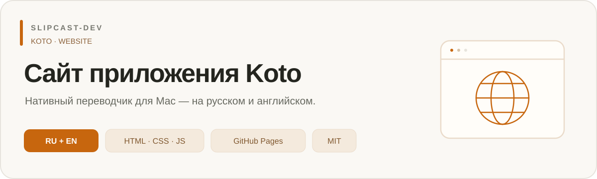

[**Русский**](README.md) | [English](README.en.md)

<p align="center">
  <a href="https://slipcast-dev.github.io/koto-website/?lang=ru"></a>
</p>

<p align="center">
  <a href="https://slipcast-dev.github.io/koto-website/?lang=ru"></a>
  <a href="#языки"></a>
  <a href="#архитектура"></a>
  <a href="#сборка-и-проверка"></a>
  <a href="LICENSE"></a>
</p>

<p align="center">
  <a href="https://slipcast-dev.github.io/koto-website/?lang=ru">Сайт на русском</a> ·
  <a href="https://slipcast-dev.github.io/koto-website/en/?lang=en">Website in English</a> ·
  <a href="https://github.com/Slipcast-dev/koto-website/actions">Статус публикации</a> ·
  <a href="VERIFICATION.md">Проверки</a>
</p>

# Koto — сайт приложения

Адаптивный сайт нативного переводчика Koto от **Slipcast-Dev** на русском и английском языках.

- [Сайт](https://slipcast-dev.github.io/koto-website/) · [English](https://slipcast-dev.github.io/koto-website/en/?lang=en)
- [Репозиторий сайта](https://github.com/Slipcast-dev/koto-website)
- [Приложение и исходники](https://github.com/Slipcast-dev/translator-Koto)
- [Проверки и ограничения](VERIFICATION.md)

## Языки

Русская страница — `index.html`, английская — `en/index.html`. Переключатель с иконкой глобуса находится справа в шапке вместо второй кнопки скачивания. Основная кнопка скачивания осталась в первом экране.

Приоритет выбора:
1. Явный `?lang=ru` или `?lang=en` в ссылке.
2. Ручной выбор, сохранённый в `localStorage` под ключом `koto.language`.
3. Основной язык браузера (`navigator.language`): `ru` и `ru-*` открывают русский, остальные — английский. Если язык неизвестен, используется английский.

Браузер обычно наследует язык системы, но сайт не имеет прямого доступа к настройкам языка ОС. Для нового посетителя используется предпочитаемый язык браузера. Повторное открытие сохраняет ручной выбор. Если хранилище заблокировано, переключение работает через параметр URL, но выбор не сохраняется между независимыми посещениями.

Локальный небольшой скрипт выполняется в `head` до содержимого. Перенаправление сохраняет параметры URL и якорь. При выключенном JavaScript автоматического выбора нет: обе страницы и ссылки переключения продолжают работать. Английская версия ссылается на английскую документацию приложения. Пример перевода намеренно сохраняет пару English → Russian и размечен атрибутами `lang`.

## Архитектура

Статические HTML/CSS и JavaScript только для выбора языка; без backend, npm, внешних шрифтов, CDN и аналитики. Сайт не собирает тексты. В браузере хранится только выбранный язык. Cookie, API-ключи и переменные окружения не нужны.

Интерфейс переводчика — фиксированная демонстрация. Apple Translation, Qwen, OCR и горячие клавиши относятся к установленному приложению. Карточки используют встроенные SVG: распознавание текста, микросхема локальных движков, Chrome; блок приватности — щит с замком. Эмблема Koto сохранена.

## Структура

| Файл | Назначение |
| --- | --- |
| `index.html`, `en/index.html` | Готовые страницы для GitHub Pages |
| `src/index.template.html` | Общий HTML-шаблон |
| `src/locales/ru.json`, `src/locales/en.json` | Тексты, метаданные и доступные подписи |
| `product.json` | Версия, требования, общие и английские ссылки |
| `assets/styles.css` | Оформление и адаптивность |
| `assets/language.js` | Определение и сохранение языка |
| `assets/koto-brandmark.png` | Эмблема и favicon |
| `scripts/build.py` | Сборка на стандартной библиотеке Python |
| `tests/` | Регрессии сборки и выбора языка |
| `robots.txt`, `sitemap.xml` | Индексация обеих страниц |
| `screenshots/` | Исторические снимки прежней русской версии; см. README внутри |
| `VERIFICATION.md`, `VERIFICATION.en.md` | Актуальный отчёт о проверках |
| `docs/assets/repository-banner.ru.svg`, `docs/assets/repository-banner.en.svg` | Информационные баннеры README |
| `LICENSE` | MIT, © 2026 Slipcast-Dev |

## Сборка и проверка

Python 3.10+; Node.js 18+ нужен только для проверки JavaScript. Сторонние зависимости не требуются.

```sh
python3 scripts/build.py
python3 -m unittest discover -s tests -p 'test_*.py'
node tests/language.test.cjs
```

Сборка проверяет HTTPS-ссылки, прямые адреса DMG/ZIP, одинаковый состав и непустые значения переводов, экранирует все подстановки. Проверка обеих локализаций завершается до записи страниц. Коммитьте исходники и сгенерированные файлы вместе.

Для просмотра:
```sh
python3 -m http.server 8765 --bind 127.0.0.1
```

Откройте [локальный сайт](http://localhost:8765/), [русскую](http://localhost:8765/?lang=ru) или [английскую](http://localhost:8765/en/?lang=en) страницу. Остановить сервер: `Ctrl+C`.

## Обновление продукта и публикация

Проверено 30 октября 2026: опубликован prerelease **0.1.0-alpha.14**, расширение **Chrome 0.1.4**. Кнопки используют прямые `browser_download_url` существующих DMG и ZIP. Ссылка «Релизы» открывает список выпусков. `/releases/latest` для alpha не используется.

При новом выпуске:
1. Проверьте файлы в GitHub Releases и требования в документации приложения.
2. Обновите `version`, `verified_on`, `links.download`, `links.extension_download` и при необходимости `platform` в `product.json`. `english_links` переопределяет ссылки на английские документы.
3. При изменении текстов обновите оба файла локализации.
4. Выполните сборку и проверки, обновите обе версии документации.
5. Отправьте изменения в `main`. GitHub Pages публикует корень этой ветки; проверяйте результат в Actions.

Адреса скачивания закреплены за выпуском и не обновляются автоматически. При смене домена измените `site_url`, сохранив завершающий `/`, и пересоберите сайт. В HTML есть canonical и hreflang; sitemap содержит обе страницы.

## Ограничения продукта

Apple Silicon, macOS 26+. Alpha имеет ad hoc подпись без Apple Developer ID/notarization: macOS может блокировать запуск. По документации приложения проверки выпуска выполнялись на macOS 27.2; macOS 26, длительный Live и часть внешних интеграций требуют дополнительной приёмки. Этот репозиторий не подтверждает работоспособность самого приложения.

Перед публикацией визуальных изменений проверяйте обе локализации на 360, 390, 768, 1024 и 1440 px, клавиатурный фокус и ссылки. Текущий объём фактических проверок указан в [отчёте](VERIFICATION.md). Сохраняйте авторство и уведомление MIT при распространении.
